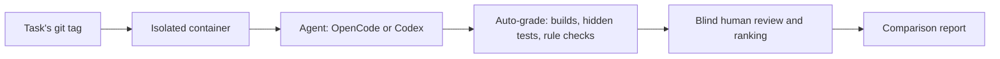

# inhouse-agent-bench

**Benchmark coding agents on tasks from your own code base.**

Public benchmarks score models on public code they may have seen in training. This one answers the question a
team actually has: *is a self-hosted model good enough for our developers, and which harness should we use?* It
runs agent harnesses (OpenCode, Codex CLI) with a self-hosted model (vLLM or any OpenAI-compatible server) or a
hosted one on real tasks cut from your repository, in an isolated container, grades the result automatically,
and helps a human grade the rest blind.

Built at PrivaSphere to decide whether self-hosted models could support its developers' agentic coding, and
open-sourced with the company's permission.



## Highlights

- **Your code, your tasks.** A task set is a folder you write for your own code base: a git tag to start from,
  a prompt, hidden tests and a grader. An [example task set](examples/python-taskset/) ships with the repo.
- **Isolation.** The agent's network has no route out; it reaches the model and the allowlisted APIs only through
  a gateway. All capabilities are dropped, `.git` is checked for tampering before and after every run, each run
  sees only its own task's history, and grading runs in a throwaway sandbox with no network
  (see [Security model](#security-model)).
- **Grading.** Gates (builds, hidden tests, no harm), automatic suggestions for correctness, procedure, reuse
  and scope, then a browser review page where a human scores every run of a task side by side, blind, and
  ranks them.
- **Load tests.** Run 1, 2, 4, 8 agents at once against the same server and see time per request, tokens per
  second per agent and aggregate throughput, with vLLM's own stats for the same window.
- **Serving recipes.** [Serving the model on RunPod](docs/serving-on-runpod.md) covers Qwen3.8-27B,
  Qwen3.8-Flash-Next (FP8, and NVFP4 on a single GPU) and GLM-5.3-Flash on RTX PRO 6000s, with measured
  [server reports](results/).

## Quickstart

Try it on the example task set against OpenAI's API, no GPU needed (needs Docker and an OpenAI platform key):

```bash
scripts/setup.sh                       # installs pinned opencode + codex, creates .env
$EDITOR .env                           # OPENAI_API_KEY and OPENAI_MODEL
docker build --network host -t llm-bench-base bench/container
docker build --network host -t llm-bench-example examples/python-taskset/container
python3 examples/python-taskset/make_workspace.py
export BENCH_TASKSET=$PWD/examples/python-taskset
BENCH_SCRIPTED=1 bench/run.sh cx openai e1-word-count     # one unattended run, graded
bench/review.py next --blind                              # score and rank it in the browser
```

Then point `BENCH_TASKSET` at a task set for your own code base (see [Task sets](#task-sets)) and the `local`
target at your model server.

## What's in the repo

1. **Launchers** (`bin/oc`, `bin/cx`) that run OpenCode and Codex CLI against your self-hosted model, or
   against OpenAI's API, with their settings locked down.
2. **A benchmark** (`bench/`) that runs those harnesses on real coding tasks in an isolated
   container, grades the result automatically, and helps a human grade the rest. The tasks come from a
   **task set**, a separate folder you write for your own code base (see Task sets); an example ships in
   `examples/python-taskset/`.

## Repository layout

| Path | What it is |
| --- | --- |
| `bin/oc`, `bin/cx` | Launchers for interactive use |
| `opencode/`, `codex/` | Harness configs, shared by the launchers and the benchmark container |
| `scripts/` | `setup.sh` (install pinned harnesses), `smoke-test.sh` (tool call on both APIs), `env.sh` (loads `.env`, target names) |
| `results/` | Model server reports (vLLM startup numbers) |
| `docs/` | [Serving the model on RunPod](docs/serving-on-runpod.md) |
| `bench/run.sh`, `bench/suite.py`, `bench/load.sh` | One benchmark run; every task, resumable; a concurrency load test |
| `bench/container/` | The base image (Node 20, both harnesses, git, Python) task set images build on, and the entrypoint |
| `bench/reset.py` | Resets the workspace to a task's base tag and runs the task set's after-reset hook |
| `bench/grade.py`, `bench/lib/checks.py` | Grading runner and generic checks |
| `bench/score.py`, `bench/lib/rubric.py` | Gates and score suggestions from a run's checks |
| `bench/lib/taskset.py` | Finds and reads the task set: the contract between the framework and a task set |
| `bench/vllm_stats.py` | Throughput and KV cache stats from a vLLM server log |
| `bench/review.py`, `bench/report.py`, `bench/regrade.py` | Human review in the browser; comparison report; grading again |
| `bench/sandbox.py`, `bench/agentnet.py`, `bench/gitguard.py`, `bench/agentgit.py`, `bench/egress-proxy.py` | Isolation (see Security model) |
| `bench/results/` | Run folders and reports (gitignored) |
| `examples/python-taskset/` | A small complete task set to try and to copy |

## Setup

```bash
scripts/setup.sh          # installs pinned opencode + codex, creates .env
$EDITOR .env              # OPENAI_API_KEY (platform key), LOCAL_API_KEY, BENCH_TASKSET
```

## Use

```bash
scripts/smoke-test.sh openai      # one tool call on the Responses API; expect PASS
bin/oc openai                     # OpenCode TUI against OpenAI
bin/cx openai                     # Codex against OpenAI

ssh -N -L 8000:localhost:8000 root@<pod-ip> -p <port> -i ~/.ssh/<key>   # in another terminal
scripts/smoke-test.sh             # same checks against vLLM
bin/oc                            # OpenCode against your model
bin/cx                            # Codex against your model
```

Run them from inside the project you want the agent to work on, e.g.
`cd ~/git/some-repo && ~/inhouse-agent-bench/bin/oc openai`.

## Targets

The launchers and the benchmark run against one of three targets. The `openai` target exercises the same
code path as `local` and gives a hosted model to compare against.

| Target | Endpoint | Used for |
| --- | --- | --- |
| `local` (default) | vLLM (or any OpenAI-compatible server) via SSH tunnel, `LOCAL_BASE_URL` | The real thing |
| `openai` (`dryrun` is its old name and still works) | `https://api.openai.com/v1`, model `OPENAI_MODEL` (or `DRYRUN_MODEL`) | A hosted model to compare against; testing config and tooling without a server |
| `chatgpt` (Codex only) | ChatGPT's Codex backend with a ChatGPT subscription login, model `CHATGPT_MODEL` | The same comparison, paid by a subscription instead of API credit |

OpenCode talks Chat Completions to the local server; Codex talks the Responses API (it no longer
supports Chat Completions for custom providers). vLLM serves both, so the smoke
test checks both. Against OpenAI both harnesses use Responses, and that is all the smoke test checks there.

The OpenCode `openai-api` provider uses OpenAI's own adapter (`@ai-sdk/openai`) rather
than the generic one used for vLLM: the generic adapter sends `max_tokens`, which
OpenAI's reasoning models reject. So an OpenCode run against OpenAI tests the harness, not
the vLLM adapter; the local smoke test covers that.

Both harnesses run OpenAI models at reasoning effort high and, like the local model, with a 131,072 token
context window (`codex/openai-api.config.toml`, the `openai-api` provider in `opencode/opencode.json`), so
scores compare on equal terms. The provider is called `openai-api` because both harnesses have a built-in
`openai` provider. Your code and the task set go to OpenAI on these runs.

### The chatgpt target: Codex on a ChatGPT subscription

Codex can sign in with a ChatGPT account instead of an API key; the `chatgpt` target runs the benchmark that
way, with the same reasoning effort and context window as `openai` (`codex/chatgpt.config.toml`). OpenCode is
not supported on it.

1. **Log in once**, with the account meant for the benchmark: `bin/cx chatgpt login --device-auth`. It prints a
   URL and a code to enter in a browser where that account is signed in. If ChatGPT refuses the device code,
   turn on device code login for Codex in the account's (or workspace's) security settings, or run
   `bin/cx chatgpt login` on a machine with a browser. A Codex personal access token works too, and suits
   unattended runs better since it is not refreshed: `printenv CODEX_ACCESS_TOKEN | bin/cx chatgpt login
   --with-access-token`. The login is kept in `.codex-chatgpt/auth.json`
   (`CHATGPT_HOME`, gitignored), apart from your personal `~/.codex`. `bin/cx chatgpt login status` checks it.
2. **Set `CHATGPT_MODEL`** in `.env`, then `bench/run.sh cx chatgpt <task>`, or
   `bench/suite.py --target chatgpt --harness cx`.

Each run borrows the login (`bench/chatgpt_auth.py`): it is copied into the run's Codex home, copied back if
Codex refreshed a sign-in (refresh tokens work only once), and deleted from the run folder however the run ends. So
runs of this target must not overlap, and `load.sh` refuses it. The agent can read the login while it runs;
its container reaches only `chatgpt.com` and `auth.openai.com`, through its own proxy port (3129). The API key
is not passed in. Codex also tries to fetch from `*.oaiusercontent.com`; that is denied and runs work without it.

Before pointing it at private code: a personal plan (Plus, Pro) may use conversations for training unless
that is turned off in the account's data controls; business plans don't. Runs count against the plan's usage
limits, so a long suite stops when they run out (a run cut off that way is graded as it stands); the report has
token counts but no cost for these runs.


## What the launchers lock down

- **OpenCode:** only the two configured providers are enabled; sharing, auto-update and the
  models.dev catalogue fetch are off; the title-generation model is the local model.
  Edits, shell commands and web fetches prompt, except read-only git/ls; web search is denied.
- **Codex:** runs with its own `CODEX_HOME` (`.codex-home/`, gitignored), so your
  personal ChatGPT login, history and memories are never used. Analytics, update
  checks and OpenAI's hosted web search are off; workspace-write sandbox, approval on request.

These are settings in the software, not guarantees. Enforce no-egress at the
firewall or container level.

## Benchmark

### What a run does

`bench/run.sh <oc|cx> <local|openai|chatgpt> <task-id>`:

1. **Checks isolation.** The agent network must have no internet and no way to the host's own services; the
   model endpoint must answer through the gateway. The workspace's `.git` must match its baseline (gitguard).
2. **Resets the workspace** to the task's base tag and runs the task set's after-reset hook in the sandbox
   (`reset.py`; for example rebuilding generated files). Runs the task's `prepare.sh` if it has one. Gives the
   run its own git folder with only the base tag's history (`agentgit.py`), mounted over `/work/.git`.
3. **Runs the agent** in the task set's image with the task prompt, as a TUI or, for scripted tasks,
   unattended (follow-up turns from `turns/`).
4. **Checks `.git` again**, then **grades** the workspace in a throwaway sandbox (`grade.py` with the task's
   `grade.py`): diff, builds, hidden tests, rule checks. Results go to `<run>/grade/auto.json`.
5. **Scores** it (`score.py`): gates (builds, behaviour, no harm) and automatic suggestions for the scores
   that need no judgement.

Each run gets a folder `bench/results/<task>/<harness>-<target>-<model>-<time>/` with `meta.txt` (including
which task set it used), the prompt, the agent's home (its transcript), `console.log` for scripted runs, and
`grade/`.

### Task sets

The framework knows nothing about your code base; a task set brings it. It is a folder, found through
`BENCH_TASKSET` (environment or `.env`), with:

```
taskset.toml        image, workspace (git repo with the tasks' base tags), deps folder (optional, read-only
                    in containers), where the agent starts, grader module, reset and run folder settings
tasks/<id>/         prompt.md, task.env (BASE_TAG=<tag>), grade.py, and optionally hidden/ (tests the
                    agent never sees), turns/ (follow-up prompts: makes the task scripted), prepare.sh
lib/<module>.py     optional: a Grader subclass with checks for your code base, your rules (RULE_BREAKS)
                    and build keys (BUILD_KEYS)
hooks/, container/  whatever its after-reset hook and image need
```

`bench/lib/taskset.py` documents every key. Task sets in use:

- `examples/python-taskset/`: a tiny Python package with two pytest-graded tasks. Start here: its README
  shows how to build it, run it, and check its graders without a model.
- Your own task set, kept in its own (possibly private) repo: point `BENCH_TASKSET` at it. Its README
  describes its workspace tags, image and setup.

### Prerequisites

- Docker, the base image `docker build --network host -t llm-bench-base bench/container`, and the task set's
  own image (see its README).
- `.env` filled in as for the launchers (see Setup), with `BENCH_TASKSET`; for `local` the SSH tunnel must be up.
- The task set's workspace and anything its README asks for (for example a deps install).

### Running

```bash
bench/run.sh cx local e1-word-count                    # one run, TUI
BENCH_YOLO=1 bench/run.sh oc local e2-slugify          # TUI with every permission auto-approved
BENCH_SCRIPTED=1 bench/run.sh cx local e1-word-count       # no TUI, unattended
bench/load.sh oc local e1-word-count 1 2 4 8           # 1, then 2, 4, 8 agents at once
```

`load.sh` runs each concurrency level in its own worktree (`~/llm-bench-load/wN`), unattended, stops runs over
`LOAD_TIMEOUT_MIN` (45), and writes a report next to its launcher logs in `bench/results/load-<time>/`.

| Variable | Effect |
| --- | --- |
| `BENCH_TASKSET` | The task set folder (environment or `.env`) |
| `BENCH_YOLO=1` | Interactive harness auto-approves everything (Codex also skips its own sandbox); recorded as `yolo=1` |
| `BENCH_SCRIPTED=1` | Run a single prompt task without a TUI |
| `BENCH_VARIANT=<label>` | Free label for anything else that differs (vLLM settings, harness version); the report keeps it in its own row |
| `GRADE_WITH_NG=1` | Passed to graders as `with_ng` (a task set's GUI tasks: also run the Angular build, about 1 GB disk, 3 min) |
| `BENCH_WORKSPACE`, `BENCH_DEPS`, `BENCH_RESULTS`, `BENCH_ENV` | Other workspace, deps folder, results folder, env file |
| `LOAD_STAGGER`, `LOAD_TIMEOUT_MIN`, `BENCH_LOAD_DIR` | load.sh: seconds between starts, per run timeout, worktree folder |

### Running a whole suite

```bash
bench/suite.py --dry-run          # what would run for the model in .env, and what is already done
bench/suite.py                    # every task with oc and cx, unattended, one after the other
bench/suite.py --harness cx e1-word-count e2-slugify    # some tasks, one harness
bench/suite.py --runs 3           # three graded runs per task and harness (for the finalists), breadth first
touch ~/suite.stop                # from another terminal: stop after the current run
```

The suite skips each task and harness that already has `--runs` (default 1) graded runs for the same target,
model, task set, `BENCH_VARIANT` and `BENCH_YOLO`, so stopping it (with `~/suite.stop`, or Ctrl+C: the unfinished run is not
graded and runs again) and starting it again carries on where it left off. Runs marked exclude in review
and load test runs don't count. A run over `--timeout-min` (45) is stopped, graded as it stands and marked
`timed_out`. When `run.sh` refuses to start a run (model endpoint down, isolation or gitguard problem), the
suite stops. Output also goes to `bench/results/suite-<yymmdd>.log`. With `--runs`, every task gets its
first run before any gets its second, so a suite stopped early still covers every task once. Raising
`--runs` later only adds the missing runs; the review page then shows all runs of a task together.

### Load tests

A load test measures how the setup copes with several agents at once, not how good their work is. It assumes
quality doesn't depend on load and measures the two separately, so its runs are graded automatically but
never reviewed, and never count as done for `suite.py`.

```bash
bench/load.sh oc local e1-word-count 1 2 4 8     # 1 agent, then 2, 4 and 8 at once (15 runs)
```

- Use a short task that is graded fully automatically. Tasks that need
  the Maven registry are refused, because the registry has a fixed port.
- Don't run a suite at the same time: both would compete for the GPUs.
- Each call makes a new group, `bench/results/load-<time>/` (launcher logs and `report.md`), and its runs are
  ordinary run folders named `...-L<level>w<slot>`, so nothing is overwritten. `bench/report.py` shows every
  group in its "Load tests" section (`--load <group>` for one).

The report is measured from the agents' side (their transcripts), one row per concurrency level:

| Column | Meaning |
| --- | --- |
| gates, auto /12 | Runs passing the gates; automatic subtotal (correctness, procedure, reuse, scope). A sanity check that load didn't break the work |
| wall min | Time per run, tool time included |
| s per request | Time per model request |
| out tok/s per agent | Output tokens per second per agent, model time only (prefill included) |
| aggregate out tok/s | All agents' output tokens over the level's wall clock: the server's useful throughput |

What it can't see is the server's side: KV cache use, requests queued for room, prefill throughput. For
that, summarise the vLLM log of the same time window. The log uses the pod's clock, which on RunPod is UTC
(check with `date` there): take the load test's start and end from its runs and convert them.

```bash
ssh root@<pod-ip> -p <port> -i ~/.ssh/<key> cat /root/vllm.log | bench/vllm_stats.py --since <start> --until <end>
```

`bench/report.html` shows the load tests as charts per concurrency level, every group in the same chart, so two
models (or two server setups) compare at a glance.

It prints the startup numbers (model memory and KV cache per GPU, maximum concurrency) and, from vLLM's
10-second stats lines, a table per number of running requests: generation throughput in total and per
request, prompt throughput, KV cache usage and the most requests waiting. Requests waiting means the server
is full (KV cache or `--max-num-seqs`): the concurrency where that starts is the setup's limit. Record both
tables with the model's server report in `results/`.

### Reviewing and reporting

```bash
bench/review.py next --blind    # grade task by task in the browser: all runs of a task side by side, ranked
bench/review.py next            # same, harness and model shown
bench/review.py task e2-slugify   # one task (again), e.g. to change a grade or a rank
bench/review.py pending         # list the runs that still need a score or a rank
bench/review.py <run>           # one run on its own, no ranking
bench/review.py <run> --pager   # terminal and $EDITOR instead of the browser (one run, no ranking)
bench/report.py                 # bench/results/report.html (open in a browser), report.md and report.csv
bench/regrade.py <run>...       # grade finished runs again with the current grader, from their saved diff
```

The review page is one page per task, with tabs:

- **Task**: the prompt (and follow-up turns), the rubric (what each dimension asks, what each score band looks
  like, the task's own notes) and the reference solution, folded away.
- **Tests & gates**: how each gate is decided for this task (the build keys its runs report, the behaviour
  rule, with the code when the task has its own), then the task's `grade.py`, everything in its `hidden/`
  and any other file it names in `GRADER_FILES`, verbatim.
- **Run A, B, ...**: one per run of the task, from every harness and model. The agent's final messages, gates
  and suggested scores, the test results (each test run the grader recorded, with every failed test named
  and its error, or the compile errors when the hidden tests did not compile; the header and the Grade tab
  name the failed tests when the behaviour gate failed), the automatic checks (`auto.json`, with each key's good value and what it measures),
  telemetry, the commands it ran, the diff side by side, the grader logs and any sections the task adds
  (T12: its findings). Each tab ends with that run's grade form. Blind, the letters are shuffled and harness
  and model hidden.
- **Grade & rank**: every run's scores side by side (the same fields as the run tabs, kept in sync), the
  running total, a gate override (below), and the ranking: order the runs from best to worst (drag, the arrows, or "Order by total"
  and then adjust). The page refuses to save until the runs are ranked.

"Save and next task" writes each run's `<run>/grade/human.json` and moves on. A run is pending when a
dimension has neither a human nor a suggested score, or when its task's runs were not all ranked together, so
a new run (the next model's suite) puts its whole task back in the queue: you grade the new runs and rank them
among the old ones, whose grades are filled in. Load test runs need no human score and never show up as
pending; `exclude` drops a run (aborted, broken) from review, the ranking and the report.

**Scoring.** Six dimensions, 1 to 10 each: correctness, procedure, reuse, scope (suggested automatically),
verification and merge-worthiness (human only). The total is their mean; a run that fails a gate (builds,
behaviour = hidden test, no harm) scores 0 and needs no scores, but is still ranked. A human score always
overrides the suggestion. Failure tags: bad tool call, loop, gave up, wrong fix, rule break, false claim.
**Gate overrides.** When a run fails the builds or behaviour gate but you judge the check wrong for that run
(say the agent solved it in a valid way the hidden test did not foresee), write the reason in "override
gate". The run then counts as passed and is scored; the failed check stays recorded, its Correctness has no
suggestion (you score it), and the report lists every override with its reason. A run that did harm cannot
be overridden. If the check is wrong for every run, fix the hidden test and `bench/regrade.py` the task's
runs instead, so past and future runs are judged alike.
The rank (`rank` of `rank_n` in `human.json`) is kept apart from the total: scores say how good a run is on
its own, the rank says which of the runs on the same task you would rather have. A `human.json` from the old
0 to 3 scale (without `"scale": 10`) is ignored, so its run is graded again.

**The report** has one row per harness, target, model, and `BENCH_VARIANT`/`yolo` when set, with totals per
task, mean scores per dimension, cost (wall time, tokens, requests) and failure tags, plus a section per load
test. `report.csv` has one row per run.

### Writing a task

1. Build the starting state in the task set's workspace repo and tag it (or reuse a tag).
2. Create `tasks/<id>/` in the task set with `prompt.md` and `task.env` (`BASE_TAG=<tag>`).
3. Write hidden tests in `hidden/` that pass on a good fix and fail on the base, and a `reference.patch`.
4. Write `grade.py` with one function `grade(g)`, calling checks on `g` (`bench/lib/checks.py`, plus your task
   set's Grader subclass). From the example task set:
   ```python
   def grade(g):
       g.record_diff(); g.diff_check()
       g.scope_check(r'^(textstats|tests)/')
       g.pytest('tests_ok', ['tests'])
       g.pytest('hidden_test_ok', [g.hidden('test_word_count_hidden.py')])
       g.wrote_tests('tests/')
   ```
   A check other task sets could use goes into `checks.py`; one only your code base needs goes into your task
   set's `lib/`.
5. If the defaults don't fit, say in the same `grade.py` how its keys map to the rubric. The defaults
   (`bench/lib/rubric.py`): the behaviour gate is `hidden_test_ok`, the build gate is every build key present,
   correctness is 3 when the hidden test passes, procedure is 3 minus broken rules, scope comes from
   `out_of_scope_files`, and there is no reuse suggestion. Optional functions:
   `behaviour(auto)`, `correctness(auto)`, `reuse(auto)`, `procedure(auto, score, broken)`. These work on a
   coarse 0 to 3 scale (`band` and `misses` help); the suggestion shown is mapped onto 1 to 10 (0, 1, 2, 3
   become 1, 4, 7, 10). `REGRADE_FROM_DIFF = False` when the result is not in the workspace diff, and
   `REGRADE_KEEP = [...]` for keys a regrade cannot reproduce from the diff (a check of untracked, generated
   files): `bench/regrade.py` takes those over from the previous `auto.json`.
6. Tell the reviewer what your checks mean, in the same `grade.py`. Without this the review page lists a key
   with no explanation and no colour:
   ```python
   # key -> (good value, what it measures). Good: True or False, 0 (any count above is bad),
   # 'high' or 'low' (more or less is better, no fixed line), or None (information only)
   AUTO_KEYS = {
       'new_regexes': (0, 'New re.sub/split/findall/compile calls in textstats/ (AGENTS.md: reuse text.py); feeds Reuse'),
   }
   # Task specific grading notes, shown under the dimension in the rubric
   RUBRIC_NOTES = {
       'reuse': 'str.split() or normalize_whitespace, not a new regex.',
   }
   ```
   Keys every task of your task set shares (a build gate, a repository rule) go in an `AUTO_KEYS` dict in
   the task set's module (`taskset.toml`: `module`) instead; the generic checks' keys are described in
   `rubric.AUTO_KEYS`. A `<key>_summary` needs no entry. `review.py` reads all three, the task's last.
7. If the grader uses test files from outside the task's `hidden/` (another task's hidden tests, a fixture in
   the task set's `lib/`), list them in `GRADER_FILES` (paths relative to the task folder), so the Tests &
   gates tab shows them next to `grade.py` and `hidden/`:
   `GRADER_FILES = ['../other-task/hidden/shared_fixture.py', '../../lib/fake_repository.py']`.
   The test results come from the logs of the test checks (`g.junit`, `g.command` with a summary, the task
   set's own): a key `K` with a `K_summary` in `auto.json` and a `K.log` in `grade/`. JUnit (RunTests),
   Jest `--verbose` and pytest output are understood (`bench/lib/testlogs.py`). If a log has another name,
   map it in `TEST_LOGS = {'hidden_test_ok': 'hidden-test.log'}`; if the behaviour gate is not
   `hidden_test_ok`, name its key in `BEHAVIOUR_TEST`.
   Start `grade.py` with a docstring that says in plain words how a run is graded (each gate, what the
   hidden tests check, how each suggestion is computed, what is left to the human): the Tests & gates tab
   shows the file, and the reviewer reads that before the code. The example task set's tasks have examples.
8. Optionally add sections to the review page with `review_sections()`, a list of
   `(title, kind, file in grade/[, options])`. Kinds: `md`, `text`, `findings` (one `path:line: text` finding
   per line, shown as a numbered list with the location set apart), `tsv` (tab separated rows; options:
   `columns` for the header, `finding_columns` for cells shown as findings, `ok` and `bad` for values to
   colour green or red).
9. Check the grader on the reference fix and on the base: `bench/reset.py <tag>`, apply the patch to the
   workspace, `bench/grade.py <id> /tmp/<id>/grade`.

### Security model

The agent can change anything in its workspace, so nothing from the workspace runs on the host:

- **Agent container:** runs as your uid with `--cap-drop ALL` and `no-new-privileges`, on the `bench-agents`
  network: `--internal` (no route out) and without a host address on it. Its only neighbour is
  `bench-gateway`, called `host.docker.internal` there, which relays exactly four ports to the host: the model
  forwarder, two allowlist HTTPS proxies (`api.openai.com:443` for the `openai` target; `chatgpt.com:443` and
  `auth.openai.com:443` for `chatgpt`) and a Maven registry for tasks
  that set `NEEDS_REGISTRY=1`. `run.sh` verifies before each run that github.com and the host's ssh port are
  unreachable.
- **Deps** (the task set's deps folder) are mounted read-only into every container.
- **Grading and the after-reset hook** run in `sandbox.py`: a throwaway container without network, with the
  workspace writable and everything else it needs read-only. The host only runs git and Python.
- **Host git** in the workspace runs with hooks and fsmonitor disabled; `gitguard.py` compares the workspace's
  `.git` hooks, config and tags with a baseline before and after each run, restores it and marks the run
  `git_tampered=1` if something changed. A moved or deleted tag counts (every run starts from one); a new
  tag does not.
- **The agent's git** is a folder in the run (`agentgit.py`) holding only the task's base tag and its history,
  mounted over `/work/.git`. The workspace's real `.git` holds every task's base and the task set's own
  branches; an agent reading it (`git log --all`) could find another task's answer or an earlier run's branches.
  Whatever the agent commits or branches stays in `<run>/agent-git`. Keep a task's answer out of its base's
  history: cut a slice before its fix, and put commits that contain fixes (a review task's base) on a side branch.

What is left: the containers share the host kernel (keep it patched), and the model forwarder and proxy see
whatever the agent sends through them.

## Serving the model

The `local` target needs an OpenAI-compatible server reachable through an SSH tunnel. How the models were
served on RunPod (pod choice and checks, vLLM install, weights, serve commands, troubleshooting) is in
[docs/serving-on-runpod.md](docs/serving-on-runpod.md); measured server reports are in [`results/`](results/).
